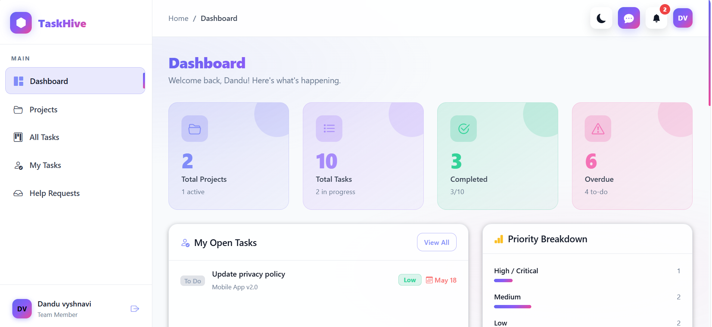
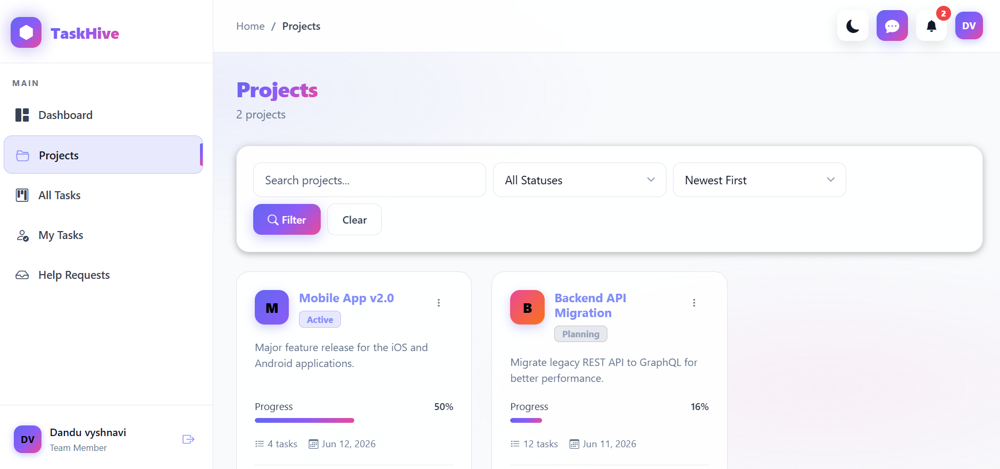
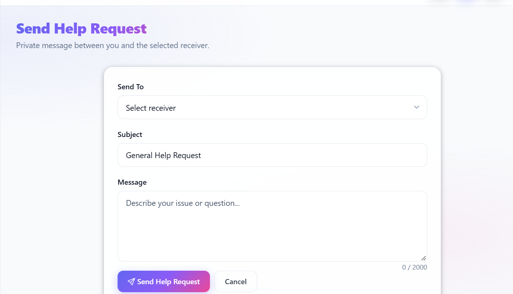

# 🐝 TaskHive — Collaborative Task & Project Manager

A production-ready, fully local web application for managing projects, tracking tasks, and collaborating with your team. Built with Django + SQLite, no cloud services required.

---

## 🚀 Features

| Feature | Details |
|---|---|
| **User Management** | Register, login, profile, role-based permissions |
| **Roles** | Admin · Project Manager · Team Member |
| **Project Management** | Create, edit, delete projects with team members |
| **Task Management** | Full CRUD, priorities, statuses, deadlines |
| **Task Comments** | Comment, edit, delete on any task |
| **Dashboard** | Stats, upcoming deadlines, activity feed |
| **Search & Filters** | Filter tasks and projects by status, priority, assignee |
| **REST API** | DRF-powered JSON endpoints |
| **Admin Panel** | Full Django admin for all models |
| **AJAX Status Updates** | Update task status without page reload |
| **Help Requests** | Send private messages to Projectmanager and Admin |

---

## Screenshots






## 📋 Requirements

- Python 3.10+
- pip
- virtualenv (recommended)

---

## ⚙️ Quick Setup

### 1. Clone / Download the project

```bash
cd taskhive
```

### 2. Create and activate virtual environment

**macOS / Linux:**
```bash
python3 -m venv venv
source venv/bin/activate
```

**Windows:**
```cmd
python -m venv venv
venv\Scripts\activate
```

### 3. Install dependencies

```bash
pip install -r requirements.txt
```

### 4. Apply database migrations

```bash
python manage.py migrate
```

### 5. Create superuser (admin account)

```bash
python manage.py createsuperuser
```

### 6. (Optional) Load demo data

```bash
python manage.py seed_data
```

This creates the following demo accounts:

| Role | Username | Password |
|---|---|---|
| Admin | `admin` | `admin123` |
| Project Manager | `sarah` | `demo1234` |
| Team Member | `alex` | `demo1234` |

### 7. Collect static files (optional for dev)

```bash
python manage.py collectstatic
```

### 8. Run the development server

```bash
python manage.py runserver
```

Visit: **http://127.0.0.1:8000**

---

## 🗂️ Project Structure

```
taskhive/
├── manage.py
├── requirements.txt
├── README.md
│
├── taskhive/               # Django project config
│   ├── settings.py
│   ├── urls.py
│   ├── wsgi.py
│   └── asgi.py
│
├── users/                  # Authentication & user management
│   ├── models.py           # Custom User model (extends AbstractUser)
│   ├── views.py
│   ├── forms.py
│   ├── urls.py
│   ├── admin.py
│   └── management/
│       └── commands/
│           └── seed_data.py
│
├── projects/               # Project management
│   ├── models.py           # Project, ProjectMembership, ProjectActivity
│   ├── views.py
│   ├── forms.py
│   ├── urls.py
│   ├── admin.py
│   ├── dashboard_views.py
│   ├── api_views.py
│   └── api_urls.py
│
├── tasks/                  # Task management
│   ├── models.py           # Task model
│   ├── views.py
│   ├── forms.py
│   ├── urls.py
│   ├── admin.py
│   ├── api_views.py
│   └── api_urls.py
│
├── comments/               # Task comments
│   ├── models.py
│   ├── views.py
│   ├── forms.py
│   └── urls.py
│
├── static/
│   ├── css/main.css        # Full custom stylesheet
│   └── js/main.js          # Interactive JS
│
└── templates/
    ├── base.html            # Sidebar layout
    └── dashboard.html
```

---

## 🔑 User Roles & Permissions

| Action | Team Member | Project Manager | Admin |
|---|:---:|:---:|:---:|
| View assigned tasks | ✅ | ✅ | ✅ |
| Update task status | ✅ | ✅ | ✅ |
| Comment on tasks | ✅ | ✅ | ✅ |
| Create projects | ❌ | ✅ | ✅ |
| Assign tasks | ❌ | ✅ | ✅ |
| Edit/delete projects | ❌ | ✅ (own) | ✅ |
| Manage users | ❌ | ❌ | ✅ |
| View all projects | ❌ | ❌ | ✅ |
| Django admin access | ❌ | ❌ | ✅ |

---

## 🔌 REST API Endpoints

| Method | URL | Description |
|---|---|---|
| GET | `/api/projects/` | List accessible projects |
| GET | `/api/projects/<id>/` | Project detail |
| GET | `/api/tasks/` | List accessible tasks |
| GET/PUT | `/api/tasks/<id>/` | Task detail / update |
| POST | `/tasks/<id>/status/` | Quick status update (AJAX) |

All API endpoints require authentication (session-based).

---

## 🔒 Security

- CSRF protection on all forms
- `@login_required` on all views
- Role-based permission checks at view level
- Django's built-in password hashing
- Input validation via Django forms

---

## 🛠️ Tech Stack

| Layer | Technology |
|---|---|
| Backend | Python 3.10+, Django 4.2 |
| API | Django REST Framework 3.14 |
| Database | SQLite (local) |
| Frontend | Bootstrap 5.3, Bootstrap Icons |
| Fonts | Plus Jakarta Sans, JetBrains Mono |
| Auth | Django built-in authentication |

---

## 📸 Pages

- `/` → Redirects to Dashboard
- `/dashboard/` → Overview stats, tasks, activity
- `/users/login/` → Login
- `/users/register/` → Register
- `/users/profile/` → My profile
- `/projects/` → Project list
- `/projects/create/` → New project
- `/projects/<id>/` → Project detail + tasks
- `/tasks/` → All tasks with filters
- `/tasks/my/` → My assigned tasks
- `/tasks/<id>/` → Task detail + comments
- `/admin/` → Django admin panel

---

## 💡 Tips

- Use `python manage.py seed_data` to populate demo content quickly
- The admin panel at `/admin/` gives full control over all data
- Task status can be updated inline on the project detail page (AJAX)
- All date inputs enforce future dates on the frontend

---

## 📄 License

MIT — free to use, modify, and distribute.
